# Manual de usuario

SGBU — Sistema de Gestión de Biblioteca Universitaria. Grupo 3, Programación IV.

## 1. Iniciar sesión

Escriba su **email o su carné** y su **contraseña**, y pulse **Ingresar** (o Enter).

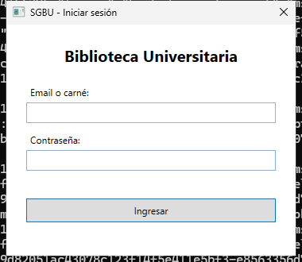

Si el usuario o la contraseña están mal, aparece un mensaje en rojo. Por seguridad el mensaje es
el mismo en los dos casos, así nadie puede averiguar qué correos están registrados.

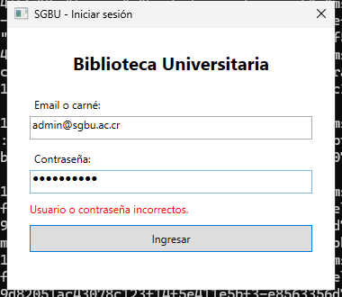

Usuarios de prueba (contraseña `Sgbu2026!`): `ADM-001` (administrador), `PRF-001` y `PRF-002`
(profesores), `EST-1001` a `EST-1005` (estudiantes).

## 2. Ventana principal

Arriba aparece su nombre, su rol y el botón **Cerrar sesión**. A la izquierda está el menú: cada
rol ve solo las opciones que puede usar.

| Opción | Administrador | Profesor | Estudiante |
|---|:-:|:-:|:-:|
| Catálogo | consulta y edita | consulta | consulta |
| Mis préstamos | ✓ | ✓ | ✓ |
| Préstamos y devoluciones | ✓ | | |
| Usuarios | ✓ | | |
| Multas | ✓ | | |
| Reportes | ✓ | ✓ | |
| Auditoría | ✓ | | |
| Configuración | ✓ | ✓ | ✓ |

## 3. Catálogo

Escriba parte del título, autor o ISBN, elija el tipo si quiere y pulse **Buscar**. Se muestran
10 materiales por página; use **Anterior** y **Siguiente** para moverse.

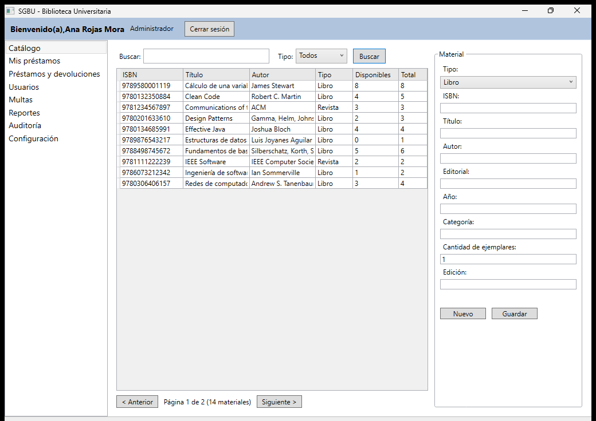

**Administrador:** al hacer clic en una fila, sus datos pasan al formulario de la derecha para
editarlos. **Nuevo** limpia el formulario para agregar otro. Los campos cambian según el tipo
(edición para libros; número y periodicidad para revistas; universidad, grado y tutor para tesis).
El ISBN debe ser un ISBN-13 válido.

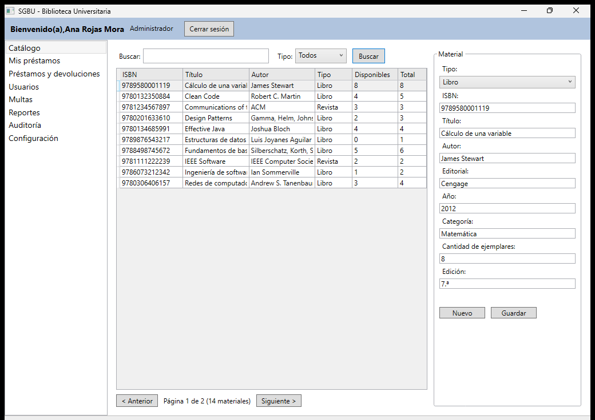

## 4. Usuarios (administrador)

Igual que el catálogo: buscar, elegir una fila para editar o **Nuevo** para agregar. El email, el
DNI (cédula o DIMEX) y el teléfono se validan. La contraseña debe tener al menos 8 caracteres; al
editar, si se deja vacía se conserva la anterior. Desmarque **Activo** para que el usuario ya no
pueda entrar.

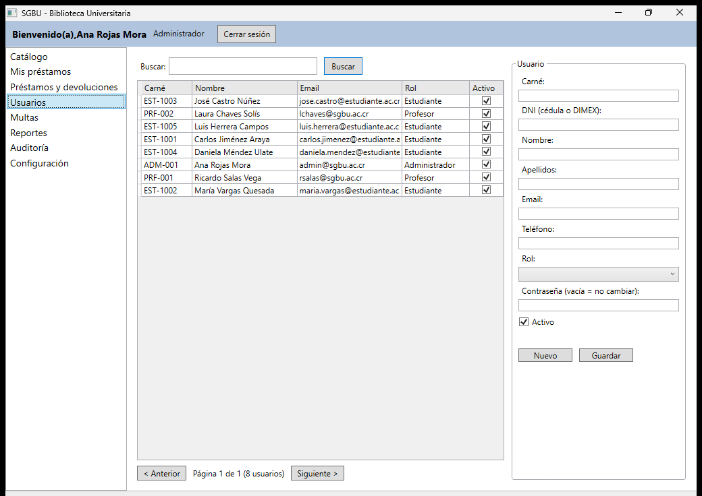

## 5. Préstamos y devoluciones (administrador)

**Prestar:** escriba el carné del usuario y el ISBN del material, y pulse **Prestar**. El sistema
revisa que el usuario esté activo, que no tenga multas pendientes, que no haya llegado al límite
de su rol y que haya un ejemplar disponible. El vencimiento depende del rol (estudiante 7 días,
profesor 14, administrador 30).

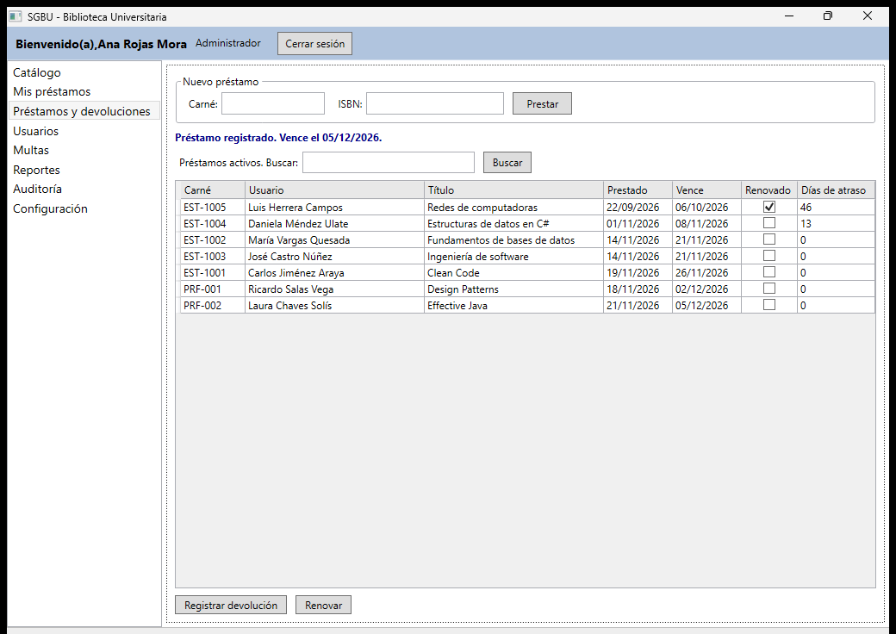

**Devolver:** elija el préstamo en la tabla y pulse **Registrar devolución**. Si llega tarde, se
crea la multa sola: ₡50 por día de atraso, con un máximo de ₡2000.

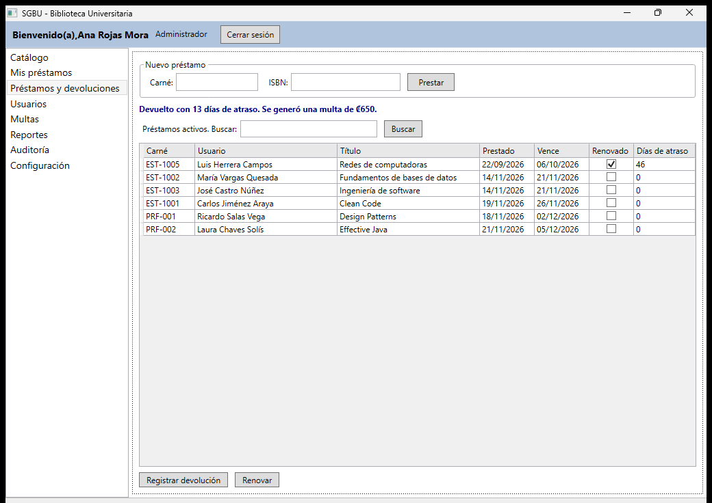

**Renovar:** elija el préstamo y pulse **Renovar**. Se puede una sola vez, no si ya venció y no si
otra persona reservó el material.

## 6. Mis préstamos (todos)

Cada usuario ve sus préstamos activos y puede renovarlos. Abajo aparecen sus multas pendientes;
mientras tenga multas no puede pedir préstamos.

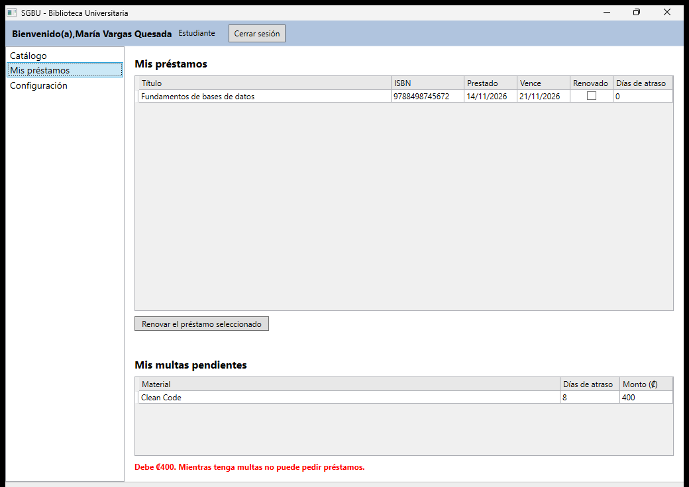

## 7. Multas (administrador)

Lista de multas pendientes con el total. Elija una y pulse **Registrar pago**.

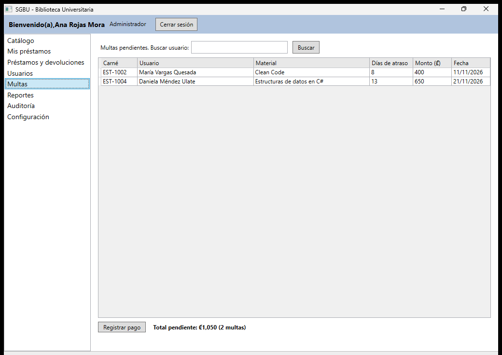

## 8. Reportes (administrador y profesor)

Elija el reporte en la lista: Top 10 más prestados (con gráfico), usuarios con multas, stock
crítico (3 ejemplares o menos) o préstamos que vencen hoy. **Exportar a PDF** y **Exportar a
Excel** guardan el reporte en un archivo.

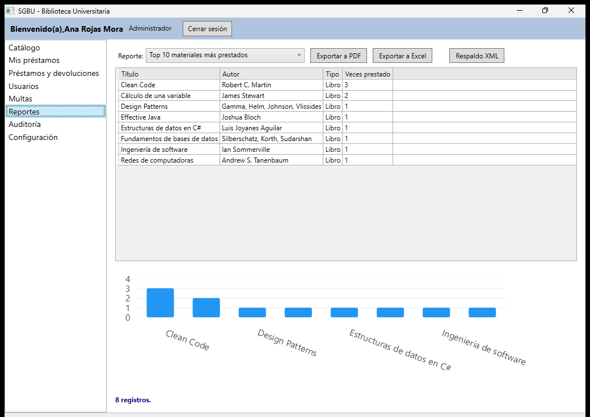

**Respaldo XML** (solo administrador) guarda materiales, usuarios (sin contraseñas) y préstamos
en un archivo XML.

## 9. Auditoría (administrador)

Muestra quién hizo qué y cuándo. Se puede filtrar por acción o usuario y por fechas.

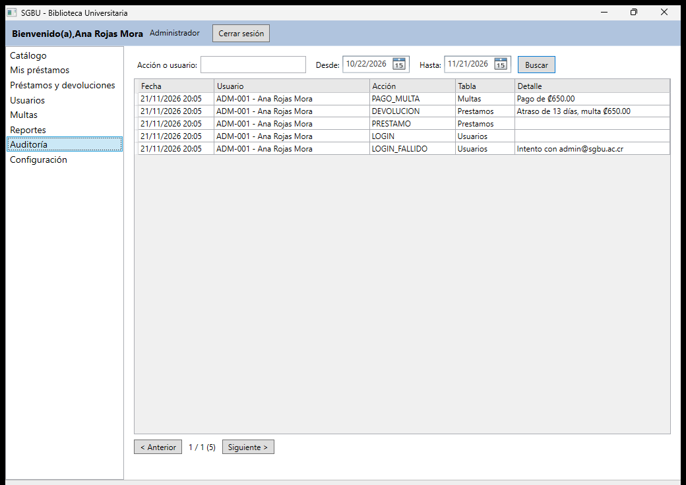

## 10. Configuración (todos)

Elija tema **claro u oscuro** e idioma **español o inglés** y pulse **Guardar y aplicar**. La
configuración queda guardada en esa computadora.

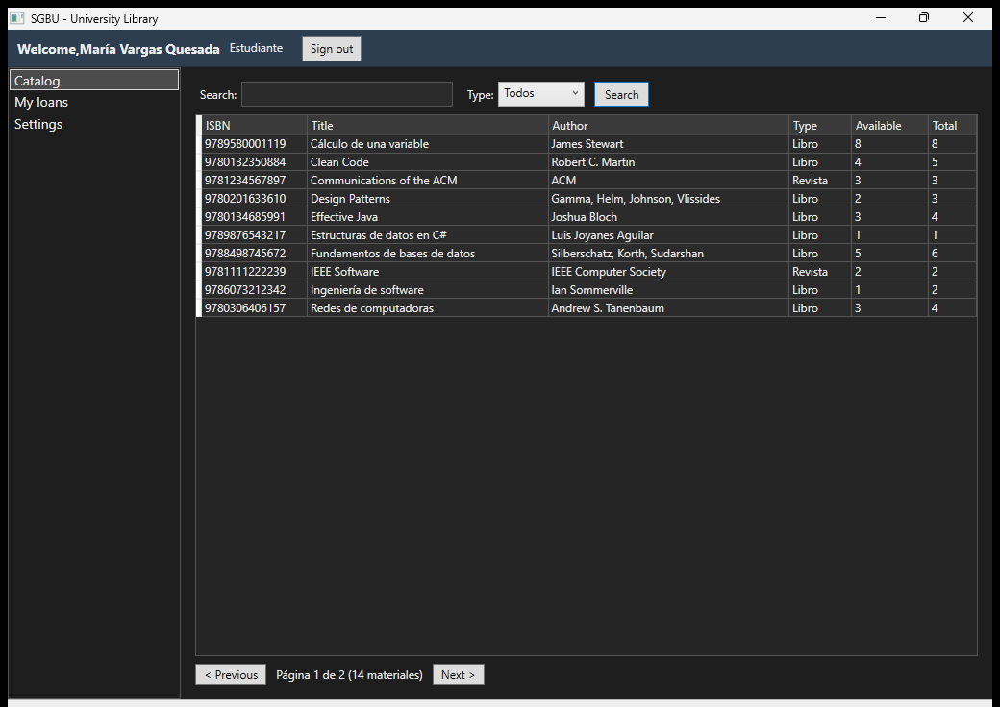
